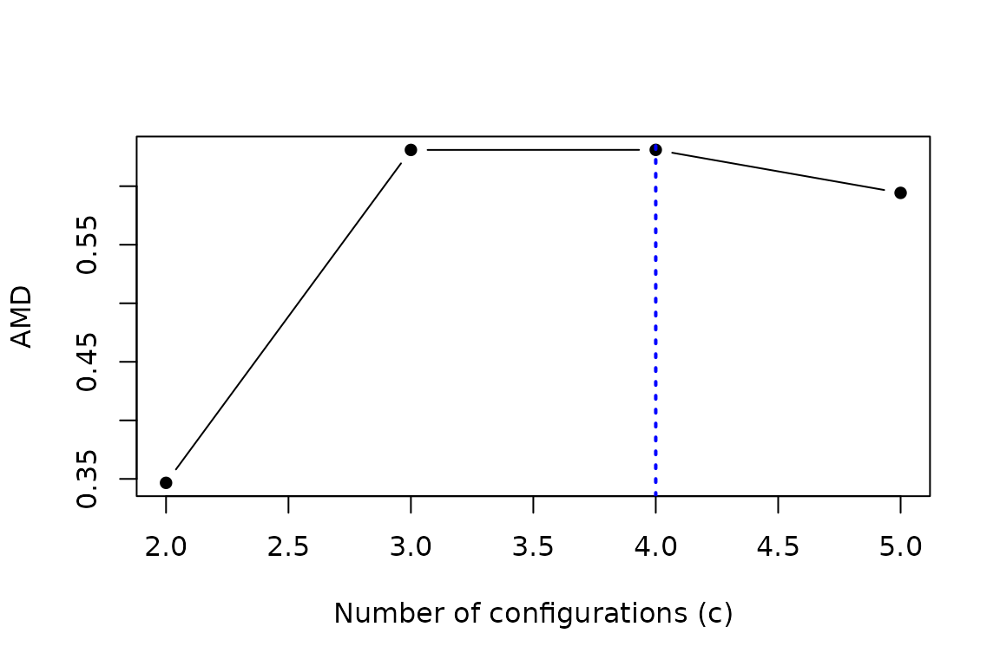

# The computational core of Average Membership Degree

## Scope

Average Membership Degree (AMD) is a summary of a soft-membership
matrix. It is not a clustering algorithm. The package currently uses
fuzzy c-means to estimate memberships when constructing an AMD curve,
but this backend is conceptually separate from the definition of the
index.

For a membership matrix $`U=(u_{ij})`$ with $`n`$ observations and $`c`$
columns,

``` math
\operatorname{AMD}(U)=\frac{1}{n}\sum_{i=1}^{n}\max_j(u_{ij})-\frac{1}{c}.
```

Therefore $`0 \leq \operatorname{AMD}(U) \leq 1-1/c`$. AMD is zero when
every row is uniform and reaches its upper bound for crisp memberships.
The formula also accepts $`c=1`$, where AMD is zero, but operational
curves compare alternative resolutions and begin at $`c=2`$.

## Constructing a curve

For each candidate $`c`$,
[`compute_amd_curve()`](https://mmendoza1967.github.io/AMDconfigurations/reference/compute_amd_curve.md)
runs several initialisations of the current fuzzy c-means backend.
Random starts are computational attempts to estimate the same solution,
not statistical replicates. The converged fit with the smallest fuzzy
c-means objective supplies the primary curve point.

The following example contains three groups by construction.

``` r

set.seed(8301)
X <- rbind(
  matrix(rnorm(90, mean = 0, sd = 0.7), ncol = 3),
  matrix(rnorm(90, mean = 4, sd = 0.7), ncol = 3),
  matrix(rnorm(90, mean = 8, sd = 0.7), ncol = 3)
)

candidate_c <- 2:5
starts <- 3L
seed_matrix <- outer(
  seq_len(starts),
  candidate_c,
  function(start, c) 100000L + 1000L * c + start
)
colnames(seed_matrix) <- as.character(candidate_c)

amd_curve <- compute_amd_curve(
  X,
  its = starts,
  nin = min(candidate_c),
  nsp = max(candidate_c),
  seeds = seed_matrix,
  iter_max = 1000,
  verbose = FALSE
)

data.frame(
  c = candidate_c,
  AMD = unname(amd_curve$curve),
  converged_starts = colSums(amd_curve$converged)
)
#>   c       AMD converged_starts
#> 2 2 0.3466353                3
#> 3 3 0.6309742                3
#> 4 4 0.6310310                3
#> 5 5 0.5942833                3

abs(amd_curve$curve[["3"]] - amd_curve$curve[["4"]])
#> [1] 5.679318e-05
```

``` r

plot(amd_curve, open_device = FALSE)
```



Named seed matrices make the mapping from `(start, c)` explicit. If a
wider candidate range uses the same master matrix, all common fits
remain identical.

New curve objects carry `schema_version = 2L`. Saved public 0.1.0
objects can still be printed, summarised and plotted from their stored
`mean` and `max` values. They emit a warning because they do not contain
objectives and fitted memberships from which the current primary curve
could be reconstructed.

This deliberately retained example also illustrates why the complete
curve is the primary object of interpretation. The data generator
contains three groups, yet the AMD values at `c=3` and `c=4` are nearly
tied and the numerical winner can be `c=4`. The subsequent decline
supports a well-defined resolution around that short plateau, but the
isolated arithmetic maximum does not by itself distinguish three
generating components from a four-part refinement. The illustrative
resolution `c=3` is specified explicitly below; neither generator
component count nor
[`which.max()`](https://rdrr.io/r/base/which.min.html) establishes a
density-mode count.

## Reading before assigning

`c_peak` and its compatibility alias `c_opt` report the first numerical
maximum of the evaluated primary curve. They do not encode a complete
scientific rule. In particular:

- a maximum at the right boundary has no observed post-peak behaviour;
- nearly equal adjacent values may represent a resolution plateau;
- exact ties are reported at the smaller `c`;
- an internal maximum should be considered with its subsequent decline,
  stability and the range examined.

The package therefore requires an explicit `c` when extracting
assignments. Here `c=3` illustrates a partition with the same number of
configurations as generator components. This does not independently
verify modal truth.

``` r

chosen_c <- 3L
assignment <- assign_configurations(amd_curve, c = chosen_c)

identical(
  assignment$membership,
  amd_curve$selected_fits[[as.character(chosen_c)]]$membership
)
#> [1] TRUE
```

## Describing stored partitions

The diagnostic interface reads the fits already stored in the curve. It
does not refit them, construct sample distances or select a number of
groups.

``` r

diagnostics <- diagnose_amd(amd_curve)
diagnostics$candidates[, c("c", "amd", "mean_winning_membership")]
#>   c       amd mean_winning_membership
#> 1 2 0.3466353               0.8466353
#> 2 3 0.6309742               0.9643075
#> 3 4 0.6310310               0.8810310
#> 4 5 0.5942833               0.7942833
diagnostics$transitions
#>   from_c to_c c_step    amd_change       ari       nmi from_fragmentation
#> 1      2    3      1  2.843389e-01 0.4365947 0.5302015          0.3333333
#> 2      3    4      1  5.679318e-05 0.8661654 0.9089745          0.1666667
#> 3      4    5      1 -3.674771e-02 0.8502425 0.9238963          0.1444444
#>   to_fragmentation
#> 1        0.1555556
#> 2        0.0000000
#> 3        0.0000000
```

The dictionary in `diagnostics$dictionary` defines each summary.
Membership entropy and top-two gaps describe membership definition, not
density or geometric compactness. Agreement between adjacent partitions
is not stability under sample resampling. The default ambiguity gap is a
descriptive convention, not a universal cutoff. Diagnostics not measured
are listed explicitly in `diagnostics$unavailable`.

## Optional model-assisted interpretation

Version 0.4.0 uses the optional drop-37 reader. It uses five fitted
random forests in an external v3 drop-37 bundle; no models are
downloaded or trained by the package. `ranger` and `digest` are needed
only for this workflow. Obtain the model file and its expected SHA-256
from the same trusted release.

``` r

reader <- load_amd_predictor(bundle_path, sha256 = bundle_sha256)
result <- predict_amd(X, reader, seed = 123, verbose = FALSE)
plot(result)
result$proposed_k
result$reference_reliability
result$agreement
result$reliability
```

The reader requires `c=2:14`, 20 principal starts, `m=2`,
`iter_max=2000`, and no scaling or variable selection. A curve already
computed with those settings can be passed as `curve`; the shorter
illustrative curve above cannot. There are also five computational
refits per c for the frozen descriptors, even when the main curve is
reused. These refits do not resample observations.

The proposed K targets the numerically resolved density-mode count used
as the simulation reference, not necessarily the number of generating
components. AMD itself does not estimate a density. The proposal is
separate from the numerical AMD maximum and does not establish the true
number of configurations. Off-grid proposals themselves are labelled
exploratory. Assignments still require the user’s explicit `c`.
Reliability estimates correctness of the emitted one/several-modes
decision and correctness of the exact proposed K, separately; it is not
directly the probability that groups exist.

The drop-37 forests retain 194 raw and 231 processed predictors. Their
own calibrators were fitted on selection only.

The reader estimates the population density-mode count. `proposed_k` is
its proposal; `agreement` describes the five forest votes. Neither
consensus nor the numerical AMD maximum is an automatic scientific
choice of resolution.

`reliability` is `NA` with status
`not_established_for_analysed_distribution`. Continuous own-calibrator
values remain in `reference_reliability`, separately for exact K and
one/several. These are estimates conditional on the reference
simulations, not certified probabilities for a new distribution.
Matching N and D does not establish distributional applicability. A
later prospective bank showed an exact-count confidence excess of 2.40
percentage points; a controlled distribution challenge showed an excess
of 6.18 points. Unanimous forests can share the same error.

Reference values are suppressed by default outside N={150,600},
D={2,6,15}, assessed output support K=1:8, or assessed missingness and
training-constant conditions. `allow_extrapolation=TRUE` exposes
off-grid reference values only; it never certifies applicability or
overrides feature/output guards. No confidence cutoff chooses K. Do not
alter data to match the numerical grid. See
`system.file("READER_EVIDENCE.txt", package="AMDconfigurations")`.

The descriptors include quadratic distance and covariance operations. A
working-memory risk guard runs before new fits; it excludes the loaded
forests and is neither a guaranteed total-memory bound nor a runtime
limit. Partition distances use all observations; global distance
summaries use a seeded sample of 2000 rows when N \> 2000, as required
by the frozen feature definition. The actual count and exact/subsampled
flags are recorded. No additional approximation bypasses the guard. The
manual workflow and stored-partition diagnostics remain usable without
these operations.

## Reproducibility record

The curve stores seeds, objectives, convergence, transformations,
retained variables and the map of complete and omitted rows. It also
links to a process-level software manifest.

``` r

manifest <- amd_reproducibility_manifest()
identical(amd_curve$manifest_id, manifest$manifest_id)
#> [1] TRUE
manifest[c("r_version", "amdconfigurations_version", "e1071_version", "rng_kind")]
#> $r_version
#> [1] "R version 4.6.1 (2026-06-24)"
#> 
#> $amdconfigurations_version
#> [1] "0.4.0"
#> 
#> $e1071_version
#> [1] "1.7.17"
#> 
#> $rng_kind
#> [1] "Mersenne-Twister" "Inversion"        "Rejection"
```

In a production analysis, retrieve the manifest immediately after every
curve and save one copy of each distinct `manifest_id`. Curves sharing
an identifier can share that copy. Each parallel worker, and each
different [`RNGkind()`](https://rdrr.io/r/base/Random.html) used within
a worker, receives its own identifier.

## Current limits

The `mean` and `max` components are preserved for compatibility with
earlier versions. They summarise all starts, including nonconverged
starts, and are not the primary curve or a basis for scientific
selection.

The package does not claim that AMD height, peak sharpness or curve
prominence measures compactness, separation or definition in a universal
sense.
